# EventHub – System Design

EventHub is an event management platform: organizations publish events and sell tickets, attendees book seats and enter with a QR code, staff check people in at the door, and an administrator moderates the platform.

| | |
|---|---|
| **Backend** | Java 21 · Spring Boot 4.1 · Spring Security 7 (JWT) · Spring Data JPA / Hibernate 7 · PostgreSQL |
| **Frontend** | Angular 19 (standalone components, signals, lazy routes) · plain CSS design system |
| **Deployment** | Docker images + docker-compose (PostgreSQL, API, nginx serving the SPA and proxying the API) |

Contents

1. [Requirements](#1-requirements)
2. [Actors and use cases](#2-actors-and-use-cases)
3. [Architecture](#3-architecture)
4. [Data model](#4-data-model)
5. [Business rules and state machines](#5-business-rules-and-state-machines)
6. [Key flows (sequence diagrams)](#6-key-flows)
7. [Security](#7-security)
8. [Concurrency and consistency](#8-concurrency-and-consistency)
9. [API design](#9-api-design)
10. [Frontend architecture](#10-frontend-architecture)
11. [Deployment](#11-deployment)
12. [Scalability and future work](#12-scalability-and-future-work)
13. [Testing strategy](#13-testing-strategy)

---

## 1. Requirements

### Functional

| # | Requirement |
|---|---|
| F1 | Visitors browse and search published events (keyword, category, city, dates, free only, past events) with pagination and sorting (date, popularity, rating, newest). |
| F2 | Users sign up / log in (email + password) and manage their profile and password. |
| F3 | A user creates an **organization** and becomes its *moderator*, or requests to join an existing one. |
| F4 | Moderators manage their team: approve/decline join requests, add members by email, change staff roles, remove members. |
| F5 | Organizers create events (draft), attach **ticket types** (free or paid, quantity, optional sale window), then publish, edit, cancel or delete them. |
| F6 | Attendees register for an event by choosing a ticket type and receive a **QR code ticket**. Free tickets are confirmed immediately, paid tickets stay *pending* until paid at the venue. |
| F7 | Attendees cancel their registration before the event starts, the seat is released. |
| F8 | Staff check attendees in by scanning (camera, USB scanner) or typing the QR code; a pending ticket can be paid and checked in at the same time. |
| F9 | Attendees who attended rate the event (1–5 stars + comment) once it has started; one review per user and event. |
| F10 | Users receive in-app notifications: registration, payment confirmation, event update, cancellation, 24 h reminder, check-in, team membership. |
| F11 | Organizers see statistics per event (registrations by status, check-in rate, revenue, sales per ticket type) and per organization, and export attendees as CSV. |
| F12 | The administrator sees platform statistics, manages users (role, enable/disable), verifies organizations, and manages categories and venues. |
| F13 | Images (event cover, organization logo, avatar) can be uploaded. |

### Non-functional

| Concern | Target / decision |
|---|---|
| Security | BCrypt password hashes, stateless JWT, role + per-organization authorization on every write, validated input, no stack traces leaked. |
| Consistency | An event or ticket type can never be oversold, even under concurrent bookings (pessimistic row lock). |
| Performance | Catalogue pages served in one query plus one batched price lookup (no N+1), DB indexes on hot filters, lazy-loaded frontend routes (initial bundle ≈ 95 kB gzipped). |
| Usability | Responsive layout (phone to desktop), light and dark themes, clear empty/loading/error states. |
| Maintainability | Feature-based packages, DTOs separated from entities, interface + implementation services, global error handler, automated tests. |
| Portability | All configuration through environment variables, Docker images for every tier. |

---

## 2. Actors and use cases

| Actor | Description |
|---|---|
| Visitor | Anonymous user, read-only access to the public catalogue. |
| Attendee (`USER`) | Registered account, books tickets, reviews events. |
| Staff member | User belonging to an organization, with a **staff role**: `MODERATOR`, `ORGANIZER`, `CHECK_IN` or `VOLUNTEER`. Their platform role becomes `ORGANIZER`. |
| Administrator (`ADMIN`) | Platform operator. |
| Scheduler | Background jobs (status transitions, reminders). |

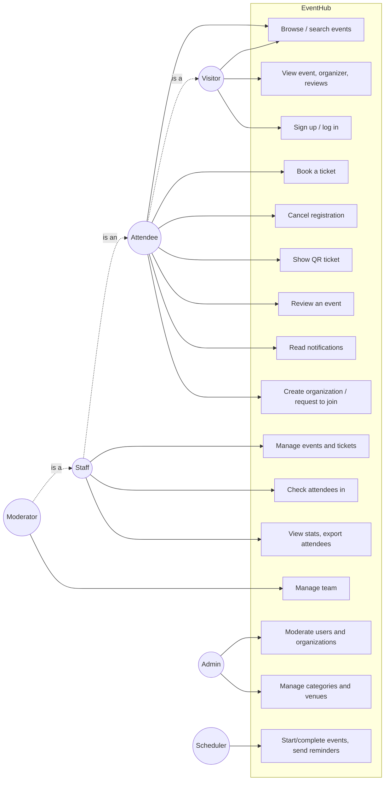

### Staff role permissions

| Action | MODERATOR | ORGANIZER | CHECK_IN | VOLUNTEER | ADMIN |
|---|:-:|:-:|:-:|:-:|:-:|
| Edit organization, manage team | ✓ | | | | ✓ |
| Create / edit / publish / cancel / delete events and tickets | ✓ | ✓ | | | ✓ |
| Check attendees in, confirm payments | ✓ | ✓ | ✓ | | ✓ |
| View dashboard, stats, attendee list, export | ✓ | ✓ | ✓ | ✓ | ✓ |

---

## 3. Architecture

### Container view

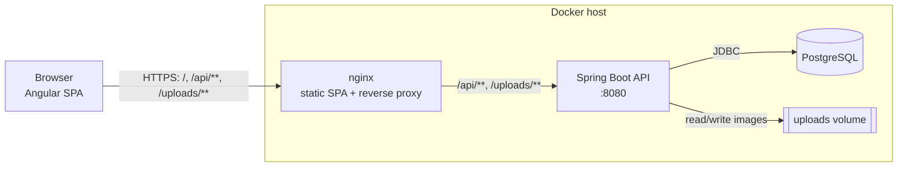

Single origin in production: nginx serves the SPA and forwards `/api` and `/uploads` to the API, so the browser never needs CORS. In development the SPA runs on `localhost:4200` and calls `localhost:8080` directly (CORS is allowed for configured origins).

### Backend layers

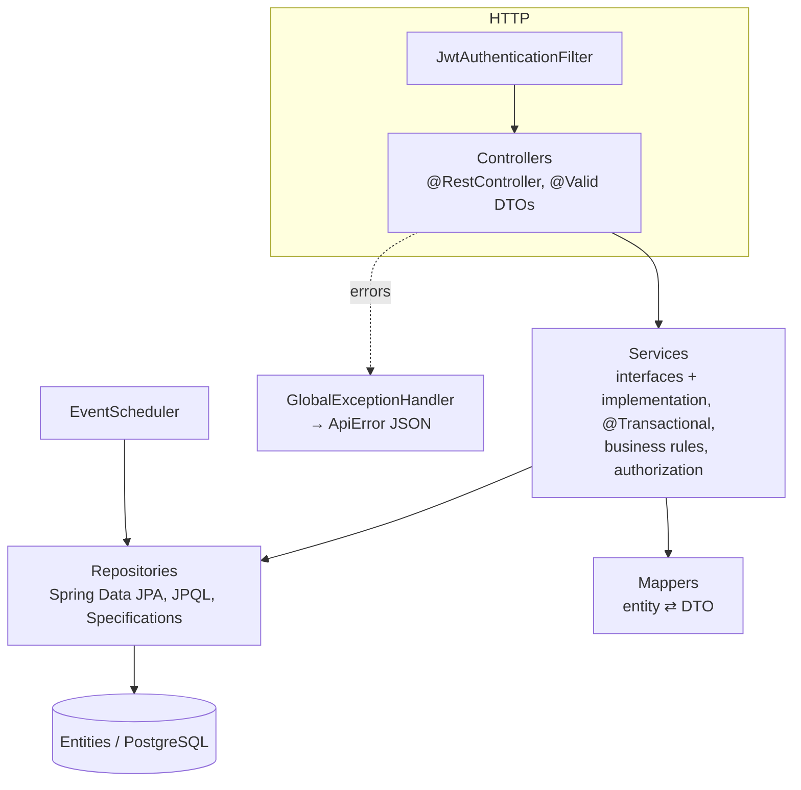

* **Controllers** only translate HTTP ↔ DTO and read the current user from `SecurityUtils`.
* **Services** hold every business rule and authorization check (via `OrganizationAccessService`), and own the transaction boundary.
* **Entities never leave the service layer**: responses are Java records built by mappers. This avoids lazy-loading surprises, infinite JSON recursion and leaking fields such as password hashes.

### Package structure (feature first)

```
tn.rnu.isetmd.event
├── admin            platform statistics, user moderation endpoints
├── auth             register / login / me
├── category         CRUD (admin)
├── common           ApiError, PageResponse, exceptions + GlobalExceptionHandler
├── config           SecurityConfig, JWT, WebConfig, DataSeeder
├── enums
├── event            events, search Specification, scheduler, stats
├── file             image upload storage
├── notification
├── organizer        organizations
├── organizerStaff   team membership + OrganizationAccessService
├── registration     booking, cancellation, check-in, CSV export
├── review
├── ticketType
├── user
└── venue
```

Each feature package contains `controller / dto / entity / mapper / repository / service / service.implementation`.

---

## 4. Data model

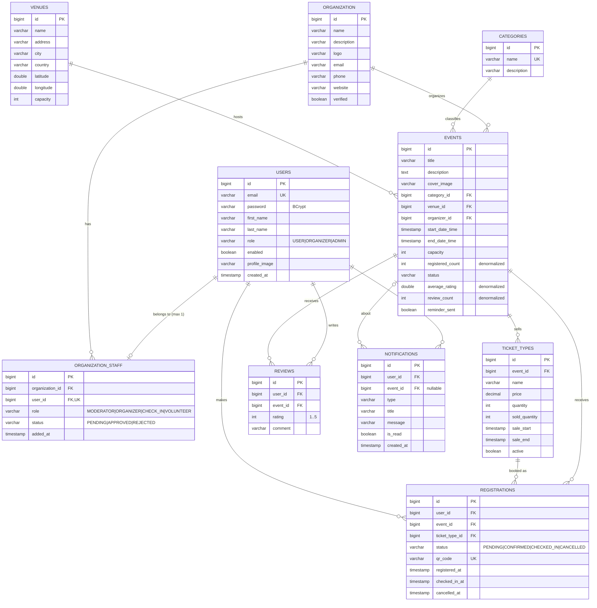

### Constraints and indexes

| Table | Constraint / index | Why |
|---|---|---|
| `users` | `UNIQUE(email)` | login identifier |
| `organization_staff` | `UNIQUE(user_id)`, `UNIQUE(organization_id, user_id)` | a user belongs to at most one organization |
| `registrations` | `UNIQUE(user_id, event_id)`, `UNIQUE(qr_code)`, index `(event_id, status)` | one registration per user and event (a cancelled one is reused), fast attendee lists and counts |
| `reviews` | `UNIQUE(user_id, event_id)` | one review per attendee |
| `events` | index `(status, start_date_time)`, index `(organizer_id)` | catalogue query and dashboards |
| `notifications` | index `(user_id, is_read)` | unread badge polled every minute |

### Denormalized counters

`events.registered_count`, `events.average_rating`, `events.review_count` and `ticket_types.sold_quantity` are stored instead of computed with `COUNT/AVG` on every catalogue read. They are updated in the same transaction as the change that affects them (registration, cancellation, review), which keeps reads cheap: the catalogue is read far more often than it is written.

### Class diagram (domain)

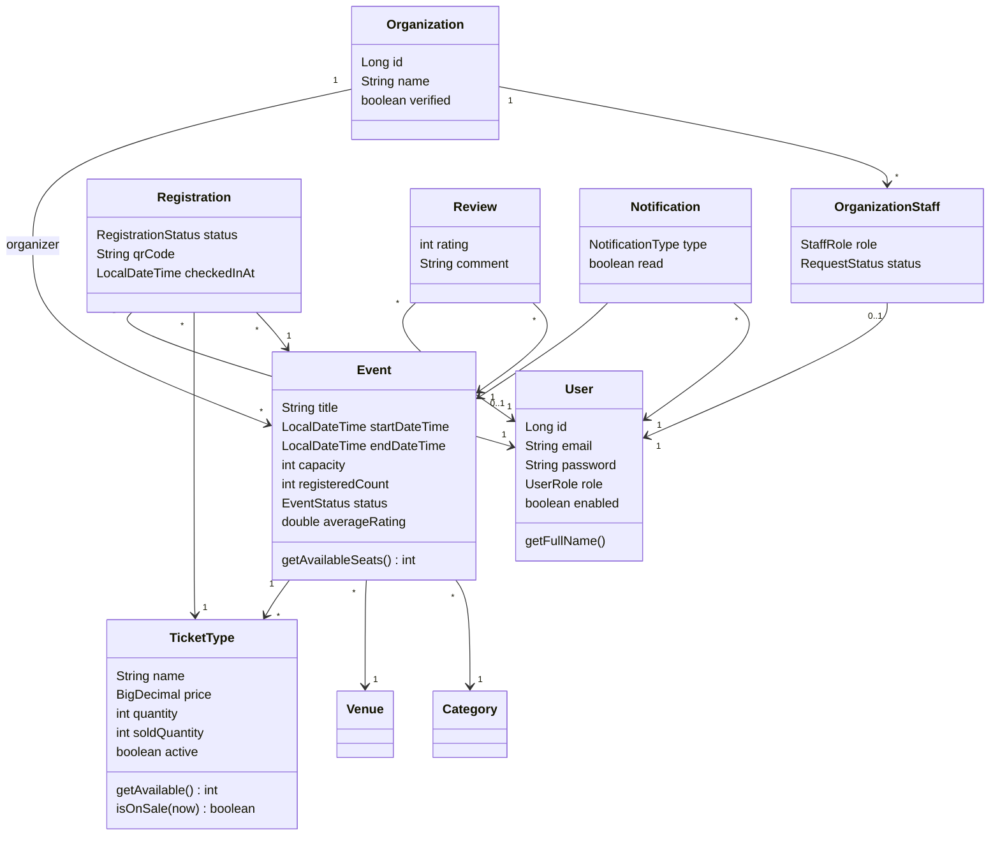

---

## 5. Business rules and state machines

### Event lifecycle

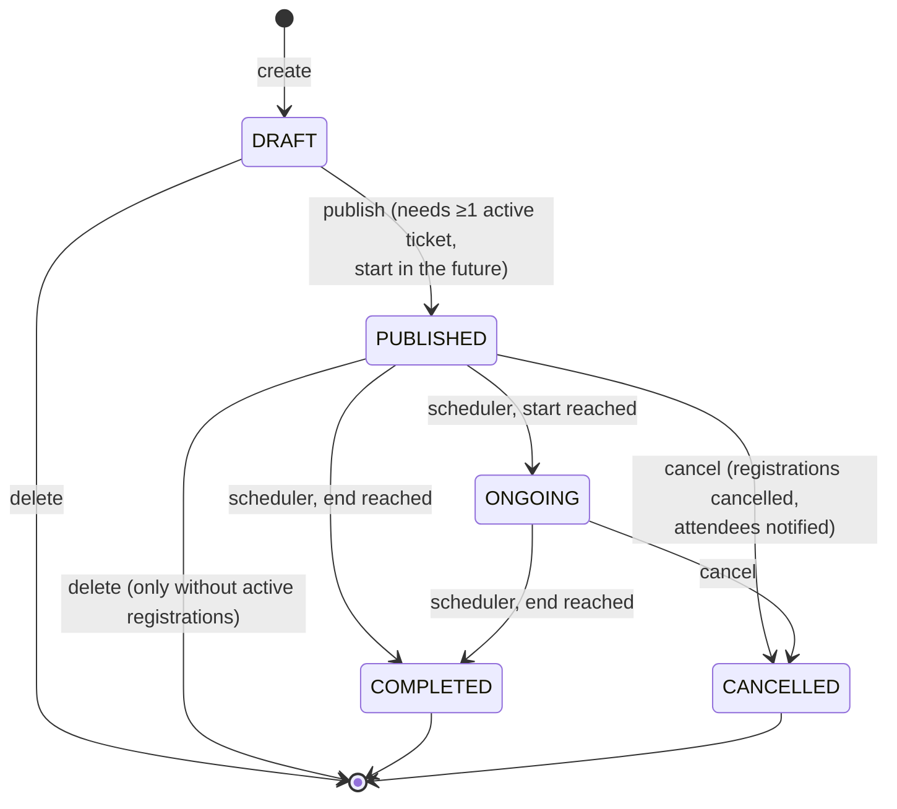

* Drafts are visible to the organization's staff only (anonymous `GET /api/events/{id}` returns 404).
* Changing the date or venue of a published event notifies attendees and re-arms the 24 h reminder.
* Capacity can't go below the number of registrations, nor above the venue's capacity.

### Registration lifecycle

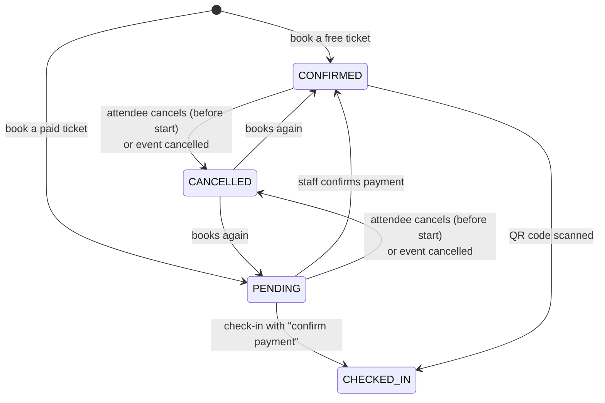

### Booking rules

A booking is accepted only when **all** of these hold, checked under the event row lock:

1. event status is `PUBLISHED` or `ONGOING` and the event has not ended,
2. the ticket type is active and inside its sale window (`saleStart ≤ now < saleEnd`),
3. `ticket.soldQuantity < ticket.quantity` (ticket stock),
4. `event.registeredCount < event.capacity` (venue seats),
5. the user has no non-cancelled registration for this event.

### Membership rules

* A user has at most one membership row. Creating an organization or joining another one is blocked while a membership is `PENDING` or `APPROVED`; a `REJECTED` row is cleared automatically.
* An organization always keeps at least one moderator (demotion and removal of the last one are refused).
* Approving a membership promotes the platform role `USER → ORGANIZER`; leaving demotes it back.

---

## 6. Key flows

### Authentication

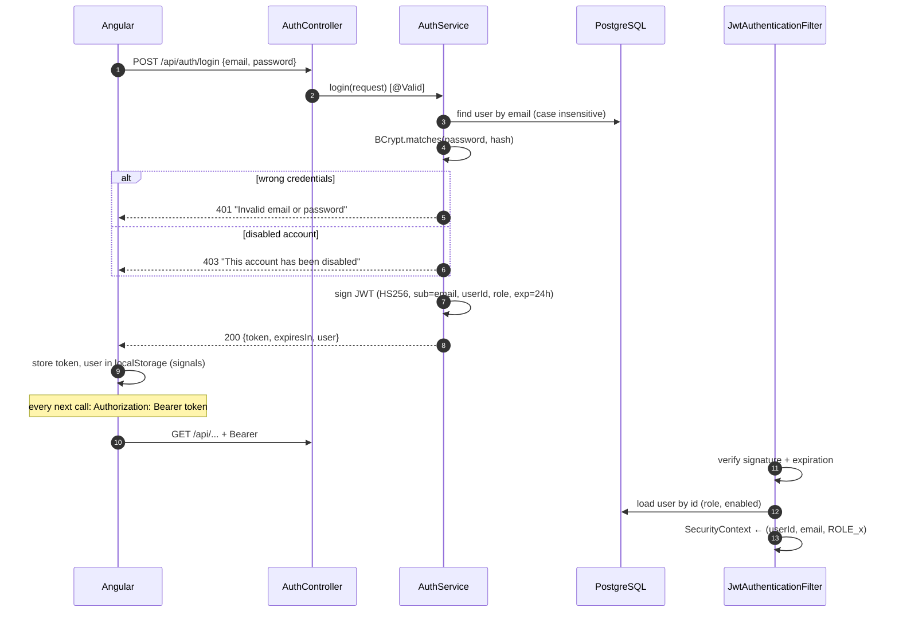

Reloading the user on each request means a role change or a disabled account takes effect immediately instead of when the token expires (24 h). The cost is one primary-key lookup per request, which can be cached later (see §12).

### Booking a ticket (concurrency safe)

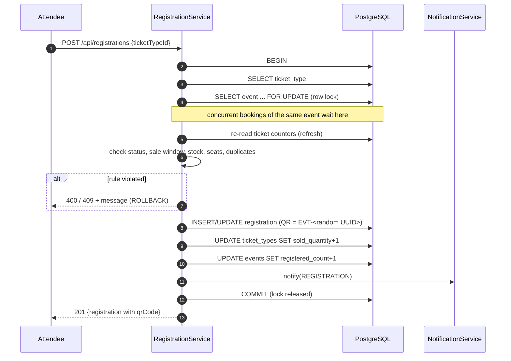

### Check-in at the entrance

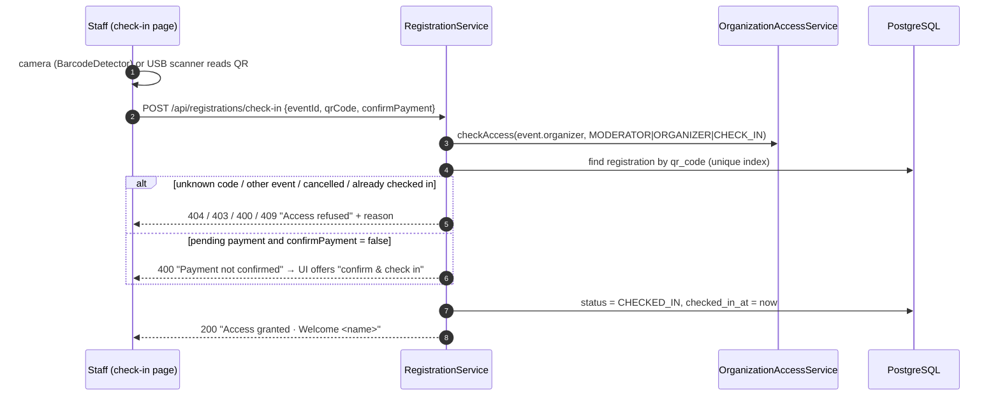

### Background jobs

| Job | Frequency | What it does |
|---|---|---|
| `EventScheduler.updateEventStatuses` | every minute | two bulk `UPDATE`s: `PUBLISHED → ONGOING` when started, `PUBLISHED/ONGOING → COMPLETED` when ended |
| `EventScheduler.sendReminders` | every 15 min | events starting within 24 h with `reminder_sent = false` → one notification per active attendee, then flag the event |

The `reminder_sent` flag makes the reminder job idempotent: restarting the API or running the job twice never sends duplicates.

---

## 7. Security

| Layer | Mechanism |
|---|---|
| Passwords | BCrypt (`BCryptPasswordEncoder`, cost 10), never returned by the API (`@ToString.Exclude`, DTOs) |
| Authentication | Stateless JWT (HS256, 24 h), secret from `JWT_SECRET`; no server session, CSRF protection disabled accordingly |
| URL rules | `SecurityFilterChain`: public `GET` catalogue, `POST /api/auth/**` open, `/api/admin/**` → `ROLE_ADMIN`, everything else authenticated |
| Method rules | `@PreAuthorize` on admin-only writes (categories, venue edit/delete, organization verification) |
| Resource rules | `OrganizationAccessService.checkAccess(orgId, roles…)` in services: the caller must be an *approved* staff member of the owning organization with an allowed staff role (or admin) |
| Ownership | registrations, reviews and notifications are checked against the current user id; someone else's resource answers **404** (no existence leak) |
| Input | Bean Validation on all request DTOs, enums parsed strictly, uploads restricted to JPEG/PNG/WEBP/GIF ≤ 5 MB and renamed to a random UUID (no path traversal) |
| Errors | `GlobalExceptionHandler` maps exceptions to `{status, error, message, path, fieldErrors}`; unexpected errors are logged and answered with a generic 500 |
| Tickets | QR payload is a 128-bit random identifier, not guessable and not derived from ids; it is only returned to its owner |
| CORS | Allowed origins from `CORS_ORIGINS`; not needed in production (same origin through nginx) |
| Login enumeration | Same message for unknown email and wrong password |

---

## 8. Concurrency and consistency

* **Overselling**: the seat counter is shared state. Booking and cancellation lock the event row with `SELECT … FOR UPDATE` (`entityManager.refresh(event, PESSIMISTIC_WRITE)`), then re-read the ticket counters. All writers of the counters go through this lock, so the checks and the increments are atomic. Verified with 40 parallel bookings on a 10-seat event: exactly 10 succeeded and 30 got 409.
* **Lost updates on unrelated fields**: `Event` and `TicketType` are annotated `@DynamicUpdate`, so an organizer editing the title only writes the changed columns and can't overwrite `registered_count` with a stale value.
* **Uniqueness races**: database unique constraints are the last line of defence (`registrations(user_id, event_id)`, `reviews(user_id, event_id)`, `users(email)`); a violation becomes a 409 through the exception handler.
* **Transactions**: every service is `@Transactional` (read-only for queries), `spring.jpa.open-in-view=false` so no SQL runs during JSON serialization.

---

## 9. API design

* REST, JSON, resource-oriented URLs under `/api`, plural nouns, sub-resources for ownership (`/api/events/{id}/ticket-types`, `/api/organizations/{id}/staff`).
* State transitions are explicit `PATCH` actions (`/publish`, `/cancel`, `/approve`, `/check-in`) rather than generic status updates, so each one can enforce its own rules.
* Status codes: `201` create, `204` delete or "nothing" (e.g. `GET /api/organizations/me` without membership), `400` validation/business rule, `401` no or invalid token, `403` not allowed, `404` missing or not visible, `409` conflict (duplicate, sold out, full).
* Pagination: `?page=&size=` and a stable envelope `{content, page, size, totalElements, totalPages, last}`.
* Dates: ISO-8601 local date-times (`2026-11-02T09:00:00`).

The full endpoint list is in [API.md](API.md).

---

## 10. Frontend architecture

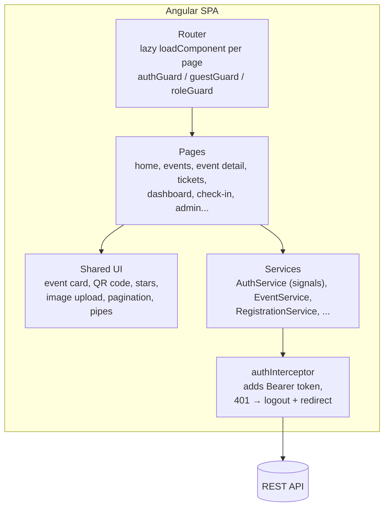

* **Standalone components + signals**: no NgModules; component state uses `signal`/`computed`, the session is a signal in `AuthService` persisted to `localStorage`.
* **Routing**: every page is lazy loaded; route params and query params are bound to component inputs (`withComponentInputBinding`). The event catalogue keeps its filters in the URL so searches are shareable.
* **Guards**: `authGuard` (redirects to login with `returnUrl`), `guestGuard`, `roleGuard('ADMIN')`. Guards are a UX convenience; the API enforces every rule.
* **Errors**: the interceptor handles expired sessions globally; pages display API messages through `SharedService.errorMessage()` and a toast service.
* **QR codes**: rendered client-side on a canvas (`qrcode` library) from the ticket identifier; scanned with the browser `BarcodeDetector` API when available, with manual or USB-scanner input as a fallback.
* **Styling**: one global design system (`styles.css`) with CSS variables, automatic dark mode (`prefers-color-scheme`), responsive grid; component styles only hold layout.

---

## 11. Deployment

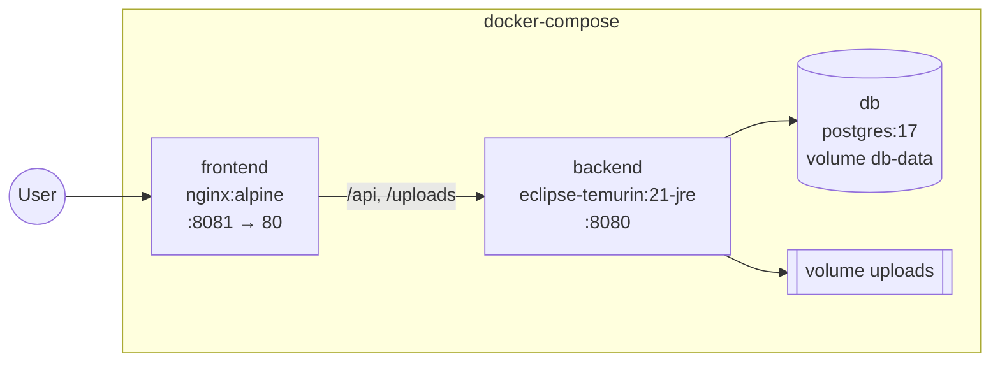

* Multi-stage builds: Maven / Node images build the artifacts, slim runtime images run them (the API runs as a non-root user).
* Configuration by environment variables: `DB_URL`, `DB_USERNAME`, `DB_PASSWORD`, `JWT_SECRET`, `JWT_EXPIRATION`, `CORS_ORIGINS`, `UPLOAD_DIR`, `SEED_DATA`, `DDL_AUTO`, `PORT`.
* The database schema is generated by Hibernate (`ddl-auto=update`) for this project; see §12 for production migrations.

---

## 12. Scalability and future work

The current design targets a university or regional platform (thousands of users, events of a few thousand seats) on a single API instance. The table below lists what to change as load grows.

| Bottleneck / need | Evolution |
|---|---|
| Schema changes in production | Replace `ddl-auto=update` with versioned **Flyway** migrations (the starter is already available). |
| Several API instances | The API is already stateless (JWT). Move uploads to object storage (S3/MinIO) behind `FileStorageService`, and run the schedulers on one node only (ShedLock). |
| User lookup on every request | Cache `userId → (role, enabled)` (Caffeine/Redis, short TTL) in the JWT filter. |
| Catalogue read load | HTTP caching / CDN for public `GET`s, Redis cache of the first catalogue pages, PostgreSQL read replica. Full-text search (PostgreSQL `tsvector` or Elasticsearch) instead of `LIKE`. |
| Very hot events (flash sales) | Replace the row lock by a conditional atomic update (`UPDATE … SET sold = sold + 1 WHERE sold < quantity`) or a Redis counter, and put bookings behind a queue. |
| Notifications | Publish domain events (`RegistrationCreated`, `EventCancelled`…) to a message broker (RabbitMQ/Kafka); consumers send in-app, e-mail and push notifications, and the UI receives them over WebSocket/SSE instead of polling. |
| Payments | Integrate a payment gateway (e.g. Konnect, Flouci, Stripe): `PENDING` registration → payment intent → webhook confirms. A reservation expiry job releases unpaid seats. |
| Observability | Spring Boot Actuator health/metrics, Prometheus + Grafana, structured logs with request ids. |
| Security hardening | Refresh tokens with rotation, rate limiting on `/api/auth/*`, e-mail verification and password reset, HTTPS everywhere (TLS at nginx). |

---

## 13. Testing strategy

| Level | Tooling | Coverage |
|---|---|---|
| Unit | JUnit 5, AssertJ | domain rules (`TicketType.isOnSale`, seat computations), `JwtService` (signature, expiration) |
| Integration (API) | `@SpringBootTest` + MockMvc on H2 (PostgreSQL mode) | auth (hashing, validation, 401/403), organization creation and roles, draft visibility, publishing rules, capacity and duplicates, paid ticket → confirm → check-in, review eligibility, cancellation notifications, staff approval |
| Concurrency | Script firing 40 parallel bookings on a 10-seat event against PostgreSQL | exactly 10 accepted |
| End-to-end | Headless Chrome (Puppeteer) through the real UI | organizer creates and publishes an event with a ticket, a new user signs up and books, staff checks the ticket in (pending → confirm → duplicate refused) |

Run the backend suite with `./mvnw test` (20 tests).
